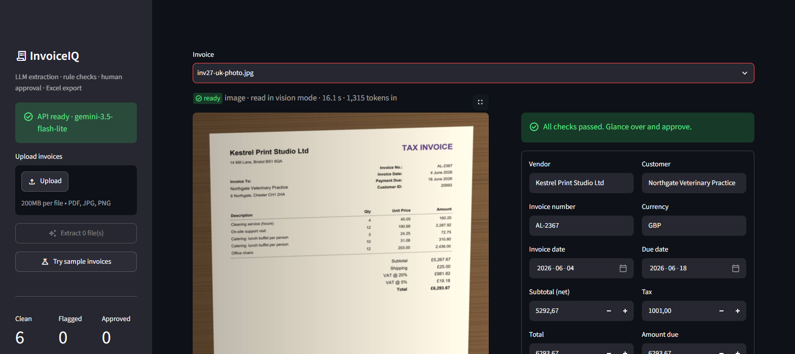
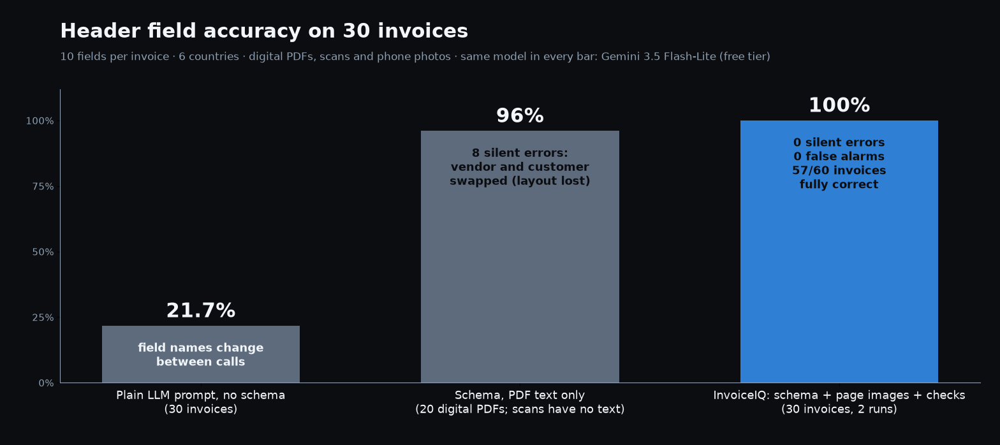

# InvoiceIQ — invoice data extraction you can check

Upload invoices (digital PDFs, scans or phone photos) and get clean, typed data in Excel. An LLM reads each invoice into a fixed schema, plain-code rules check the result (do the totals add up? is the date read in the right country convention? is the value really on the page?), and a person reviews **only the fields that were flagged** before anything is exported.



> All invoices in this repo are synthetic (fictional companies, generated by `scripts/b1_dataset.py`) so every true value is known and accuracy can be measured exactly.

## Results

Measured on 30 invoices from 6 countries (US, UK, Germany, Switzerland, France, Netherlands): 20 digital PDFs, 5 scans, 5 phone photos. Same model throughout, Gemini 3.5 Flash-Lite (free tier).

| Approach | Header field accuracy* | Silent errors** |
|---|---|---|
| Plain prompt, "return JSON", no schema | **21.7%** | – (field names change between calls, so code can't find the values) |
| Schema, PDF text only (20 digital PDFs) | 96.0% | **8**: vendor and customer swapped on every invoice where the customer's name is printed bigger |
| **InvoiceIQ**: schema + page images + rule checks | **100%** in both runs | **0** |

\* 10 fields per invoice: vendor, customer, invoice number, invoice date, due date, currency, net, tax, total, amount due.
\** A wrong value that was *not* flagged for review: the dangerous kind.

InvoiceIQ in detail (two independent runs, `eval/results/eval_auto.md` and `eval_auto-r2.md`):

- 600/600 header fields correct; 57/60 invoices fully correct including every line item.
- The 3 remaining errors (a shipping charge listed as a line item on long 2-page invoices) were all flagged. 0 silent errors, 0 false alarms.
- Scans and phone photos: 10/10 fully correct in both runs.
- About 10–13 s and 1,750 input tokens per invoice on the free tier.



### What the measurements taught

- **A schema is the biggest single win (22% → 96%).** Without one, the model renames fields on every call (`tax` / `sales_tax`, `total` / `gross_amount`) and copies dates as printed (`03/04/2026`).
- **Text extraction loses layout.** With PDF text alone, the two address blocks merge into one line and the model can't tell who billed whom. Sending the page image fixes it. Image-only and text+image were equally accurate on headers (within run-to-run noise); text+image kept the headers at 100% in both runs, so PDFs use both.
- **Checks catch what the model gets wrong.** In one development run the model copied the printed net amount that excluded shipping. `subtotal + tax ≠ total` flagged it and suggested the correct value.

## How it works

```
upload (PDF / JPG / PNG)
   │
   ▼
reader ── digital PDF: text layer + page images
       ── scan / photo: page images only (EXIF rotation fixed, resized)
   │
   ▼
extract ── LLM with structured output (pydantic schema → JSON schema)
        ── one automatic retry if the JSON doesn't fit the schema
   │
   ▼
validate ── 13 rule checks, no AI: totals, tax rate, amount due vs deposit,
            line-item math, shipping rows, date order per country, due ≥ issue date,
            currency code, vendor ≠ customer, required fields, "is it in the PDF text?",
            and fields the model itself marked as uncertain
   │
   ▼
review screen ── flagged fields highlighted with the reason; edits are re-checked;
                 approving with open flags needs an explicit confirmation
   │
   ▼
export ── Excel (Invoices + Line items sheets, real dates and numbers) or CSV
```

| Part | File |
|---|---|
| Schema (the contract the LLM must fill) | `app/schema.py` |
| File reading (PDF text + rendering, photos) | `app/reader.py` |
| Extraction, modes `text` / `vision` / `hybrid` / `auto` | `app/extract.py` |
| Rule checks | `app/validate.py` |
| Evaluation (per-field accuracy, caught vs silent errors) | `app/evaluation.py`, `eval/run_eval.py` |
| Excel / CSV export | `app/export.py` |
| HTTP API (FastAPI) | `app/api.py` |
| Review screen (Streamlit, talks only to the API) | `ui/app.py` |
| LLM providers: Gemini (default, free tier), Claude, NVIDIA | `app/llm.py` |

## Run it

You need Docker and a free Gemini API key from https://aistudio.google.com/apikey.

```bash
echo GOOGLE_API_KEY=your-key > .env
docker compose up -d --build
```

Open http://localhost:8501 and click **Try sample invoices**, or upload your own. API docs: http://localhost:8000/docs.

Without Docker (Python 3.12 + [uv](https://docs.astral.sh/uv/)):

```bash
uv sync
uv run uvicorn app.api:app --port 8000
uv run python -m streamlit run ui/app.py
```

Use Claude instead of Gemini: set `LLM_PROVIDER=anthropic` and `ANTHROPIC_API_KEY` in `.env`. To protect the API, set `APP_API_KEY`; the UI sends it automatically.

### API

```bash
curl -F "file=@data/invoices/inv27-uk-photo.jpg" "http://localhost:8000/extract?include_pages=false"
```

Returns the invoice fields, every check with its result, and `flags` (field → reasons). `POST /validate` re-checks an edited invoice; `POST /export` turns approved invoices into Excel or CSV.

### Reproduce the numbers

```bash
uv run python -m scripts.b1_dataset                         # regenerate the 30 invoices + truth.json
uv run python -m eval.run_eval                              # InvoiceIQ (auto mode) on all 30
uv run python -m eval.run_eval --mode text --only pdf --name text-pdf
uv run python -m scripts.b2_baseline                        # the no-schema baseline
uv run pytest                                               # 42 tests, no API key needed
```

## Limits (honest)

- The test set is synthetic and small (30 invoices). Real invoices bring handwriting, stamps, crumpled paper and many more layouts; expect lower accuracy until it is tested on a client's own documents. That's why the review step exists.
- The "is it on the page?" check only works for digital PDFs. On scans and photos a misread invoice number is caught only if another check or the model's own uncertainty flags it.
- Two runs per configuration. A one-run difference of a field or two is within LLM noise.
- Exports to Excel and CSV. Google Sheets or an accounting API (QuickBooks, Xero, DATEV) would be a small extra module on top of `/export`.
